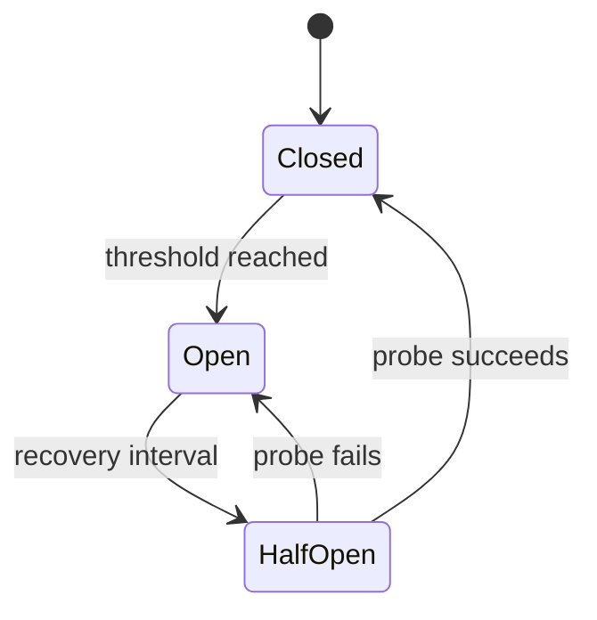

## Failure is part of the interface

A procurement agent can have correct prompts, safe tools and strong evaluation
and still fail because a provider is unavailable, a database is slow, an API
changes shape, retrieval disappears or a dependency asks it to slow down.
Reliability is not the claim that those events never happen. It is the ability to
end each unit of work in a controlled, observable state.

Week 20 extends the Week 19 execution boundary with one deterministic queue
worker. It handles five required failures through the same policy path rather
than hiding them inside five unrelated demonstrations. Every accepted job ends
as:

- `completed`: the primary dependency produced a valid result;
- `degraded`: a declared fallback produced a valid but visibly reduced result;
  or
- `dead_letter`: processing stopped and retained safe diagnostic metadata.

If retries, queues and circuit breakers are new, start with the
[beginner version]({{ '/weeks/week-20/beginner/' | relative_url }}).

| Time | Focus | Evidence to retain |
| --- | --- | --- |
| Hour 1 | Define failure contracts | transient/permanent classification and terminal states |
| Hour 2 | Add deadlines and retry budgets | finite attempts, capped delay and safe operation list |
| Hour 3 | Add circuit breakers | dependency-scoped closed/open/half-open transitions |
| Hour 4 | Design model and tool fallbacks | compatible contracts and visible degradation |
| Hour 5 | Process work through a queue | lease, acknowledgement, idempotency and redelivery |
| Hour 6 | Isolate partial failure | per-item result and continued batch processing |
| Hour 7 | Quarantine terminal failures | minimal DLQ record, alert and redrive policy |
| Hour 8 | Exercise all five incidents | tests, smoke output and production gap review |

## Start with a failure taxonomy

“Something failed” is not enough information to choose a safe action. Classify
the outcome before deciding whether to retry, fall back or stop.

| Class | Examples | Same-request retry? | Week 20 behavior |
| --- | --- | --- | --- |
| transient availability | connection reset, temporary provider outage | sometimes, within a budget | backoff; circuit may open |
| overload or throttling | rate limit with `Retry-After` | sometimes, after bounded delay | honor bounded delay, then retry |
| deadline exceeded | call did not finish in the accepted time | only if the operation is safe and budget remains | discard late response; backoff |
| contract invalid | missing required fields, wrong type or impossible value | no; the unchanged response is not likely to heal | stop or use a declared compatible fallback |
| authorization/configuration | denied permission, invalid key, bad endpoint | generally no | fail and repair configuration or authority |
| ambiguous write outcome | timeout after a consequential call began | not automatically | reconcile state; require domain idempotency or fresh approval |

The lab retries only `unavailable`, `rate_limited` and `timeout`. An apparently
successful supplier response missing `supplier_id` and `risk` becomes
`invalid_response` and is not replayed.

This classification belongs in trusted adapter code. A model should not decide
that its own failed write is safe to repeat.

## Put a deadline on every remote call

Without a deadline, slow work holds threads, tasks, sockets, connection-pool
slots and queue leases. Enough slow calls can make the caller fail even while
the dependency eventually returns data.

A useful timeout design distinguishes:

- connection establishment from the end-to-end request;
- one attempt's deadline from the caller's total deadline;
- cancellation from merely stopping your wait;
- a confirmed failure from an unknown side-effect outcome; and
- dependency latency from time already spent in queue and backoff.

The lab's `timeout_ms=100` is a policy fixture. A database response with
`elapsed_ms=250` is classified as a timeout and its late data is ignored. No
socket exists, so this proves classification only. Production adapters must use
the client's real timeout/cancellation mechanism and release resources.

Choose deadlines from the user journey and measured dependency latency—not from
a convenient round number. A downstream attempt cannot consume more time than
the remaining upstream budget.

## Retry less than your first instinct

A retry spends more dependency capacity. It helps when a rare transient fault
lands on a healthy system. It hurts when many callers repeat work against an
overloaded system.

Every retry policy needs at least:

1. a closed set of retryable outcomes;
2. a safe operation contract;
3. a maximum attempt or elapsed-time budget;
4. capped backoff between attempts;
5. randomized jitter in a real multi-client system;
6. one deliberate retry layer; and
7. metrics for attempts, recovery and exhaustion.

The lab uses capped exponential delay:

~~~text
delay(n) = min(max_backoff, base_backoff * 2 ** (n - 1))
~~~

It omits jitter so exact virtual delays can be asserted in tests. A production
client should normally use a proven SDK that adds jitter, preventing clients
that failed together from retrying together.

Do not add independent three-attempt loops in the SDK, repository, service,
worker and broker. Those budgets multiply. Pick the layer that understands the
operation and owns the remaining deadline.

## Idempotency is a business contract

An operation is safe to retry when repeating the same intent cannot duplicate
an unwanted effect. Reads are often idempotent. “Create payment,” “send email”
and “approve purchase” are not automatically safe.

An idempotency key helps only when the receiver durably binds that key to the
semantic request and its terminal result. It must detect a key reused for
different work, survive process restarts and coordinate concurrent callers.

The local queue binds an idempotency key to `(tenant, scenario)`. An identical
replay is suppressed; reuse across another tenant or scenario is rejected. This
is an in-memory demonstration, not exactly-once delivery.

Week 19 approvals remain one-use. If an approved write times out after dispatch,
do not feed it into this read-like retry loop. Reconcile whether the effect
happened and obtain a fresh decision where policy requires it.

## Respect rate limits without parking forever

A throttling response often tells the client when to try again. The lab combines
that signal with its own backoff:

~~~text
delay = max(exponential_backoff, min(retry_after, retry_after_cap))
~~~

The catalog API asks for 300 virtual milliseconds. The worker advances its
manual clock by 300 ms and the next primary call succeeds. The result is
`completed/recovered_after_retry`, not degraded, because no fallback ran.

Cap the accepted value. A malformed or extreme `Retry-After` must not hold a
worker indefinitely. In production, also consider a global retry budget, queue
age and the caller's remaining deadline before scheduling another attempt.

## Stop calling a dependency that is probably down

A circuit breaker remembers recent failure state for one dependency:

- **Closed:** calls flow; successes reset consecutive failures.
- **Open:** calls fail fast without spending a dependency attempt.
- **Half-open:** a limited probe tests recovery.

The LLM provider, database and vector store each open after two failures in the
lab. Their state is isolated: a broken vector store must not block the catalog
API. A healthy fallback has its own circuit.

Circuit scope is a design decision. One global database circuit can block every
shard because one shard failed. One circuit per request learns too little to be
useful. Choose an endpoint/shard/region/tenant scope that matches independent
failure domains, and coordinate half-open probes under concurrency.

A circuit is not an exception handler, health check or repair mechanism. Record
state changes, alert on them and still return a controlled caller result.

## Fallback is a different product state

A fallback is safe only when it has a declared contract, known quality and
capacity for outage traffic. “Try another thing” is not a design.

| Primary failure | Declared fallback | Contract preserved | Visible reduction |
| --- | --- | --- | --- |
| primary model unavailable | secondary model | `answer` and `model` | different model selected |
| database exceeds deadline | bounded cache | `orders`, `source`, `freshness` | data is 45 seconds old |
| vector store unavailable | lexical search | `documents`, `retrieval` | semantic retrieval is absent |

The worker labels all three `degraded/fallback_used` and names the selected
dependency. That prevents stale cache data or lower-recall retrieval from being
mistaken for the normal path.

The invalid supplier API has no declared fallback, so it stops. Fabricating
default supplier risk would be less reliable than an honest failure.

Model fallback needs the same scrutiny as tool fallback. Check structured output
shape, context limits, safety behavior, supported features, latency, cost and
quality. A secondary provider that depends on the same region or quota may share
the primary failure.

## Queue work to isolate time and failure

Queue-based processing separates accepting work from executing it. The worker
uses four explicit transitions:

| Transition | Meaning |
| --- | --- |
| submit | record one semantic job and idempotency key |
| lease | give one worker temporary responsibility and increment delivery count |
| acknowledge | persist a terminal completed/degraded result and remove the lease |
| requeue or dead-letter | schedule another bounded delivery, or quarantine terminal work |

Real brokers usually provide at-least-once delivery: a worker can finish an
effect and crash before acknowledgement, so the message appears again. The
consumer must expect duplicates.

The local queue is single-process and deterministic. Production needs durable
messages, lease/visibility renewal, crash-safe result storage, backpressure,
queue-age limits and a safe relationship between acknowledgement and side
effects. An outbox/inbox or conditional domain write is often more honest than
claiming “exactly once.”

## Preserve partial success

A batch is a collection of item outcomes, not one boolean. If job three has an
invalid response, jobs four and five may still be independent and useful.

`python -m labs.week_20.demo batch` produces five ordered results:

| Position | Scenario | Terminal state |
| --- | --- | --- |
| 1 | LLM-provider outage | degraded through secondary model |
| 2 | database timeout | degraded through bounded cache |
| 3 | invalid API result | dead letter |
| 4 | vector-store failure | degraded through lexical search |
| 5 | rate-limit errors | completed after retry |

This is deliberate partial failure. The caller can show four useful outcomes and
one precise problem instead of discarding all work or pretending everything
succeeded.

For dependent items, encode that dependency explicitly. Continuing after a
prerequisite failed can be worse than stopping. The rule is “isolate independent
work,” not “always continue.”

## Treat the dead-letter queue as an operating workflow

A dead-letter queue isolates work that exceeded a delivery budget or failed
permanently. It prevents a poison item from blocking the main queue and retains
evidence for diagnosis.

The lab's invalid API job enters the DLQ on its first delivery because replaying
the same contract-invalid result is not useful. Its record contains only:

- job and tenant identifiers;
- scenario and controlled code;
- delivery count; and
- dependency-attempt count.

A production DLQ needs ownership:

1. alert when entries arrive or age;
2. retain them long enough for diagnosis under a data policy;
3. inspect code, configuration and payload class safely;
4. repair the cause;
5. authorize and rate-limit redrive; and
6. verify idempotency before replay.

Blind automatic redrive creates a loop between source and DLQ. Storing raw
secrets or arbitrary exception text creates a second sensitive data system.

## Make degraded behavior observable

Reliability patterns can hide incidents if they turn every failure into a 200
response. Record dimensions that explain the path:

- dependency, operation and classified outcome;
- attempt number, backoff and remaining deadline;
- circuit state and transition;
- primary versus fallback selection;
- queue age, delivery count and lease duration;
- completed, degraded and dead-letter rates; and
- DLQ age, size, cause and redrive result.

Avoid high-cardinality raw payloads and secret-bearing errors. Correlation IDs
and controlled codes usually provide better operational joins.

Define service objectives around user-visible success and freshness. A response
from stale cache may satisfy an availability objective while missing a
freshness objective. Count it honestly.

## Run and inspect the lab

From the repository root:

~~~shell
python -m pip install -r requirements-dev.txt
python -m labs.week_20.demo case --scenario llm-provider-outage
python -m labs.week_20.demo case --scenario database-timeout
python -m labs.week_20.demo case --scenario invalid-api-result
python -m labs.week_20.demo case --scenario vector-store-failure
python -m labs.week_20.demo case --scenario rate-limit-errors
python -m labs.week_20.demo batch
python -m labs.week_20.demo smoke
~~~

In each JSON result, inspect `status`, `code`, `selected_dependency`, `warnings`,
`attempts` and `delivery_count`. For each attempt, check whether a call actually
ran, how it was classified, its virtual delay and the circuit state afterward.

Run the focused verification:

~~~shell
python -m pytest tests/test_week20_reliability.py -q
python -m ruff check labs/week_20 tests/test_week20_reliability.py
python -m ruff format --check labs/week_20 tests/test_week20_reliability.py
python -m mypy --strict --explicit-package-bases labs/week_20 tests/test_week20_reliability.py
~~~

The tests cover strict boundary rejection, retry classification and caps,
`Retry-After`, deadline handling, circuit transitions and isolation, fallback
contracts, queue state transitions, idempotency conflict, partial continuation,
DLQ minimization, deterministic replay and every CLI scenario.

## Production readiness checklist

Before applying these patterns to a real dependency, answer:

- Which outcomes are transient, permanent or ambiguous?
- Is the exact operation idempotent, and who durably enforces that?
- Where is the one retry layer, and what is its attempt/time/load budget?
- Do timeouts cover connection, request and cancellation cleanup?
- Does backoff include jitter and respect the caller's remaining deadline?
- What resource scope owns the circuit, and how are probes coordinated?
- Does each fallback preserve shape, authority and acceptable semantics?
- Can the fallback handle primary-outage traffic, and is degradation visible?
- Are queue acknowledgement and effects safe across worker crashes?
- Who owns DLQ alerts, retention, diagnosis and authorized redrive?
- Do metrics distinguish normal, recovered, degraded and terminal outcomes?
- Have failure paths been exercised under realistic concurrency and load?

The deterministic lab answers policy questions. It does not prove real provider
availability, cancellation, broker durability, fallback quality or capacity.

## Further reading

- AWS Builders' Library:
  [Timeouts, retries, and backoff with jitter](https://aws.amazon.com/builders-library/timeouts-retries-and-backoff-with-jitter/)
- AWS Well-Architected Framework:
  [Control and limit retry calls](https://docs.aws.amazon.com/wellarchitected/latest/framework/rel_mitigate_interaction_failure_limit_retries.html)
- Microsoft Azure Architecture Center:
  [Circuit Breaker pattern](https://learn.microsoft.com/en-us/azure/architecture/patterns/circuit-breaker)
- Amazon SQS:
  [Using dead-letter queues](https://docs.aws.amazon.com/AWSSimpleQueueService/latest/SQSDeveloperGuide/sqs-dead-letter-queues.html)
- Google SRE:
  [Addressing cascading failures](https://sre.google/sre-book/addressing-cascading-failures/)

