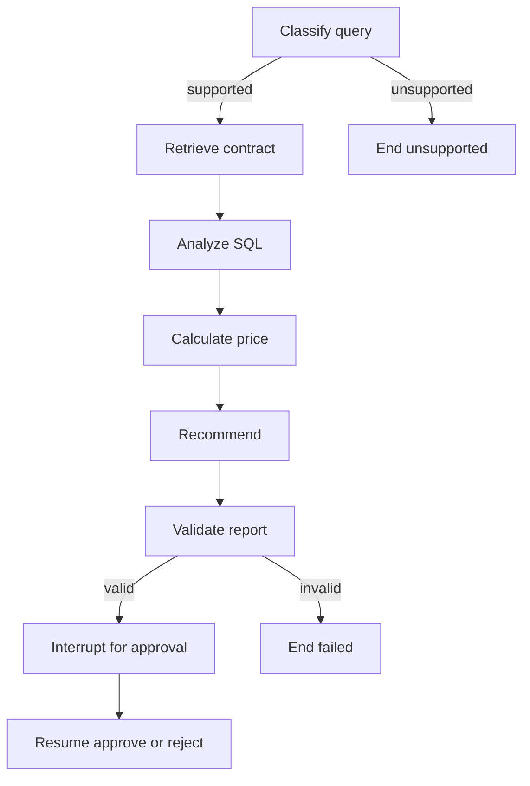

# Week 15: checkpointed LangGraph investigation

This lab turns the Week 14 procurement workflow into a real LangGraph
`StateGraph`. It is deliberately local and deterministic so you can inspect
state, routing, reducers, checkpoints and interrupts without a model or API key.

## What the graph does



The graph handles three fictional cases:

| Case | Variance | Contract result | Recommendation |
| --- | ---: | --- | --- |
| `price-spike` | 10.00% | 5.00% threshold | `review_required` |
| `stable-price` | 2.00% | 5.00% threshold | `no_review` |
| `missing-terms` | 10.00% | no applicable term found | `needs_human` |

Every supported case pauses at `awaiting_approval`. A recommendation is not an
approval, including `no_review`.

## Set up and run

From the repository root in an activated environment:

```shell
python -m pip install -r requirements-dev.txt -r labs/week_15/requirements.txt
python -m labs.week_15.demo run --case price-spike --thread week15-run
python -m labs.week_15.demo resume-demo --case price-spike --decision approve
python -m labs.week_15.demo resume-demo --case missing-terms --decision reject
python -m labs.week_15.demo smoke
python -m pytest tests/test_week15_langgraph.py -q
```

`run` shows the approval interrupt. `resume-demo` starts and resumes within one
process because the lab uses `InMemorySaver`. A second CLI process cannot recover
that checkpoint. Use a durable supported checkpointer for cross-process or
production recovery.

## Read the implementation in this order

1. `LOGIC.md` defines accepted rules and exclusions.
2. `models.py` defines graph state, reducer channels and approval contracts.
3. `fixtures.py` contains local document results and parameterized SQLite work.
4. `graph.py` defines nodes, conditional edges, validation and `GraphRuntime`.
5. `demo.py` projects framework state into stable JSON for experiments.
6. `tests/test_week15_langgraph.py` proves topology and runtime behavior.

The `evidence` and `trace` lists use additive reducers. Each node returns only its
partial update; LangGraph combines list updates in execution order while replacing
ordinary scalar values. Report validation separately checks that both required
evidence categories exist.

## Inspect the pause and resume boundary

The interrupt payload includes:

- a JSON-safe report;
- the exact report digest;
- the permitted decisions; and
- a generated response schema for decision, reviewer and digest.

Resume uses `Command(resume=...)` with the same `thread_id`. The approval node is
restarted, so all work before `interrupt()` is side-effect free. The host response
is validated again in application code and a mismatched digest is rejected.

The reviewer name is only a synthetic host value. `thread_id` is a checkpoint
cursor, not an identity. SHA-256 snapshot binding is not authentication or a
digital signature.

## Boundaries

- LangGraph is pinned in `requirements.txt` for reproducibility.
- SQLite exists only in memory for one analysis call.
- Contracts and prices are fictional, local and dated.
- No provider, prompt, network, document database or external write is used.
- `InMemorySaver` loses all checkpoints when the process exits.
- GitHub Pages publishes the lesson, not this Python runtime.

Use the official [Graph API](https://docs.langchain.com/oss/python/langgraph/graph-api),
[persistence](https://docs.langchain.com/oss/python/langgraph/persistence) and
[interrupt](https://docs.langchain.com/oss/python/langgraph/interrupts) guides
alongside the code.

