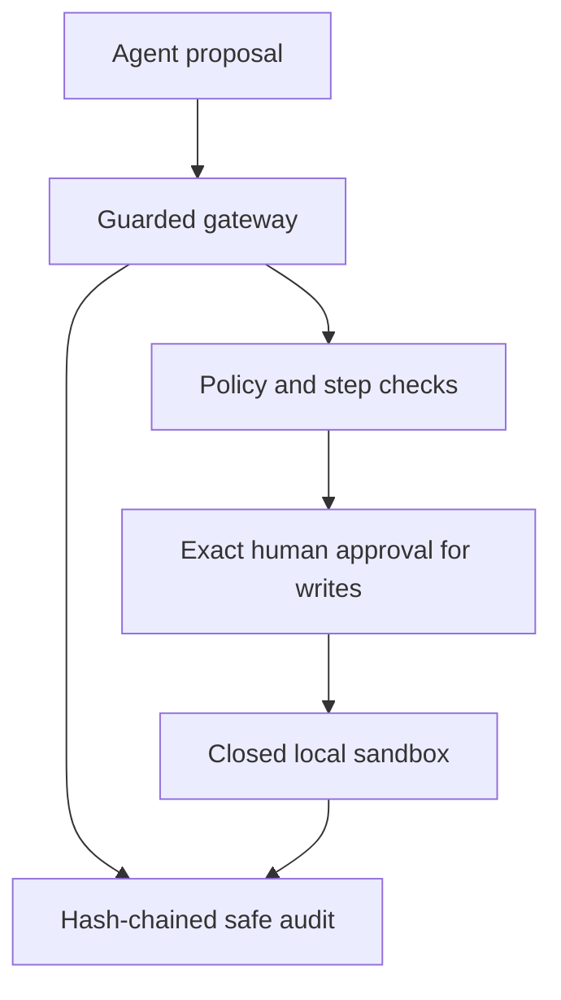

# Week 19: enforce agent safety before tools run

This local lab adds a deterministic safety gateway in front of synthetic
procurement tools. The agent may propose a call, but trusted application code
decides whether the named tool, permission, arguments, step budget and human
approval allow execution.

No model, provider, API key, network, database, filesystem, shell, subprocess,
dynamic code or external procurement action participates. The sandbox is an
in-memory teaching dispatcher, not an operating-system security boundary.

## Control flow



Prompt text cannot bypass this flow. `TrustedScope` supplies tenant, principal,
run, case and permissions outside the request. The request contains no field
that can grant itself authority.

## Tool surface

| Tool | Mode | Required permission | Approval | Local behavior |
| --- | --- | --- | --- | --- |
| `contract_lookup` | read | `contract:read` | no | read one tenant-scoped contract |
| `purchase_order_lookup` | read | `order:read` | no | read one tenant-scoped order |
| `supplier_risk_lookup` | read | `risk:read` | no | read one tenant-scoped risk record |
| `review_flag_set` | write | `review_flag:write` | exact, one use | update one synthetic review flag and issue undo receipt |
| `review_flag_revert` | write | `review_flag:revert` | fresh exact, one use | restore the prior flag if no newer write conflicts |

An approval binds tenant, principal, run, case, request ID, tool and canonical
argument SHA-256. Changing any field invalidates the grant. A valid grant is
consumed before dispatch, so retrying a failed write requires a new human
decision.

## Run it

From the repository root in the declared development environment:

```shell
python -m pip install -r requirements-dev.txt
python -m labs.week_19.demo case --scenario read
python -m labs.week_19.demo case --scenario write-without-approval
python -m labs.week_19.demo case --scenario approved-write
python -m labs.week_19.demo case --scenario reversal
python -m labs.week_19.demo case --scenario secret-rejected
python -m labs.week_19.demo case --scenario max-steps
python -m labs.week_19.demo case --scenario tool-failure
python -m labs.week_19.demo smoke
```

Every command emits JSON. The audit projection includes identities, tool,
controlled decision code, sequence, argument digest, predecessor hash and event
hash. It deliberately excludes raw argument values and internal exception text.

Run the focused gates:

```shell
python -m pytest tests/test_week19_agent_safety.py -q
python -m ruff check labs/week_19 tests/test_week19_agent_safety.py
python -m ruff format --check labs/week_19 tests/test_week19_agent_safety.py
python -m mypy --strict --explicit-package-bases labs/week_19 tests/test_week19_agent_safety.py
```

## Scenario guide

| Scenario | Expected evidence |
| --- | --- |
| `read` | permitted tenant-scoped read and two-event chain |
| `write-without-approval` | `approval_required`; flag remains unchanged |
| `approved-write` | exact grant consumed, flag changed, undo receipt returned |
| `reversal` | separately approved reversal restores the earlier value |
| `secret-rejected` | secret-like key rejected; raw value absent from audit |
| `max-steps` | third request blocked when the configured budget is two |
| `tool-failure` | stable `tool_failure`; synthetic internal detail suppressed |

Other tests prove unknown tools and extra/coerced arguments fail closed, a grant
cannot cross tenant/principal/run/case/request/tool/arguments, replayed approval
fails, undo cannot cross tenants, a stale undo cannot overwrite newer state and
event mutation or reordering invalidates the supplied audit chain.

## Audit properties and limits

The chain starts from 64 zeroes. Each event hash covers the event's safe fields
and predecessor hash. Verification detects editing and reordering in the events
it receives. It does not authenticate the writer, stop deletion or reveal that a
valid suffix was removed. Production needs a protected append-only store,
authenticated event origin, durable checkpoints or signed heads, retention,
monitoring and tested log-failure behavior.

“Full audit logging” means complete lifecycle coverage, not logging everything.
Passwords, authorization values, API keys, access tokens, connection strings and
raw tool payloads do not belong in ordinary audit events. The reversal token is
a declared sensitive capability accepted only by its fixed tool; audit keeps only
the arguments digest.

## Read the implementation in this order

1. `LOGIC.md` defines the accepted behavior and limitations.
2. `models.py` closes trusted scope, request, approval, result and audit contracts.
3. `safety.py` implements the registry, exact approvals, audit chain, sandbox and
   gateway.
4. `demo.py` exposes seven inspectable scenarios and a 12-check smoke command.
5. `tests/test_week19_agent_safety.py` provides the 29 behavior and failure checks.

## What changes in production

Replace the in-memory trusted scope with authenticated identity and server-side
authorization. Enforce least privilege again in each downstream service. Keep
approval issue/consume state durable and transactional with the action. Put
secrets behind short-lived handles from a secret manager. Run risky tools in
real process or container isolation with filesystem, network, CPU, memory and
time limits. Store audit events separately with restricted access and tamper
evidence anchored outside the process.

Approval is one control, not permission laundering. A broad “always approve”
decision can outlive the context a reviewer intended. Prefer per-action grants
for consequential tools and show the reviewer the exact normalized action.

Read the [OWASP Excessive Agency guidance](https://genai.owasp.org/llmrisk/llm062025-excessive-agency/),
[OWASP AI Agent Security Cheat Sheet](https://cheatsheetseries.owasp.org/cheatsheets/AI_Agent_Security_Cheat_Sheet.html),
[OWASP Logging Cheat Sheet](https://cheatsheetseries.owasp.org/cheatsheets/Logging_Cheat_Sheet.html),
[NIST least-privilege definition](https://csrc.nist.gov/glossary/term/least_privilege),
[OpenAI Agents SDK human-in-the-loop guide](https://openai.github.io/openai-agents-python/human_in_the_loop/)
and [OpenAI tools isolation warning](https://openai.github.io/openai-agents-python/tools/)
alongside the code.
