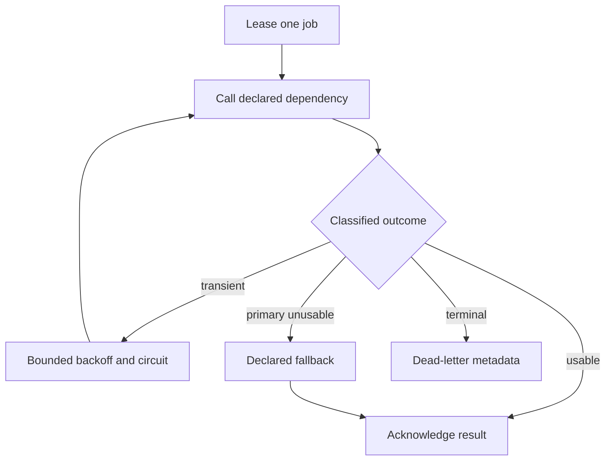

# Week 20: survive dependency failure without hiding it

This local lab runs five deterministic failure simulations through one queue
worker. It separates transient faults from permanent contract failures, bounds
retry and delivery budgets, opens per-dependency circuits, invokes only declared
fallbacks, continues after a failed batch item and retains a minimal dead-letter
record.

No model, provider, API key, network, database, vector store, broker, wall clock,
sleep or external procurement action participates. The code is a teaching
simulator, not a production reliability library.

## Control flow



Each job owns its terminal transition. A failed item never turns the whole batch
into one undifferentiated exception.

## Run it

From the repository root in the declared development environment:

```shell
python -m pip install -r requirements-dev.txt
python -m labs.week_20.demo case --scenario llm-provider-outage
python -m labs.week_20.demo case --scenario database-timeout
python -m labs.week_20.demo case --scenario invalid-api-result
python -m labs.week_20.demo case --scenario vector-store-failure
python -m labs.week_20.demo case --scenario rate-limit-errors
python -m labs.week_20.demo batch
python -m labs.week_20.demo smoke
```

Every command emits deterministic JSON. Run the focused gates:

```shell
python -m pytest tests/test_week20_reliability.py -q
python -m ruff check labs/week_20 tests/test_week20_reliability.py
python -m ruff format --check labs/week_20 tests/test_week20_reliability.py
python -m mypy --strict --explicit-package-bases labs/week_20 tests/test_week20_reliability.py
```

## Scenario guide

| Scenario | Attempts | Terminal evidence |
| --- | --- | --- |
| `llm-provider-outage` | primary unavailable twice; circuit opens; secondary called | `degraded`, `fallback_used`, `model-secondary` |
| `database-timeout` | two responses exceed 100 ms; circuit opens; cache called | `degraded`, visibly stale `bounded-cache` data |
| `invalid-api-result` | response is nominally OK but required fields are absent | no retry; `dead_letter/invalid_response` |
| `vector-store-failure` | vector store unavailable twice; lexical tool called | `degraded`, `lexical-search` |
| `rate-limit-errors` | 300 ms `Retry-After`; second call succeeds | `completed/recovered_after_retry` |

`batch` submits all five in that order. It returns five terminal results: one
completed, three degraded and one dead-lettered. The invalid item is third, so
the fourth and fifth outcomes prove partial-batch continuation.

## What the records mean

An `AttemptRecord` states the dependency, attempt number, whether an invocation
happened, classified outcome, simulated elapsed time, scheduled virtual delay
and circuit state. It does not contain arbitrary exception text or credentials.

`degraded` is a success with reduced behavior, not another spelling of normal.
The response identifies the selected fallback and includes warnings. Cache data
states its age, and lexical retrieval states its method.

A `DeadLetterRecord` contains only job/tenant correlation, scenario, controlled
code, delivery count and dependency-attempt count. It is enough for this lab's
diagnosis without copying an untrusted payload into a second store.

## Retry safety

The automatic calls are read-like synthetic operations. A timeout does not prove
that a remote write did nothing. Do not apply this retry loop to Week 19's
approval-bound write, a payment, message, deletion or other consequential action.
Those need an idempotent domain contract, durable reconciliation and sometimes a
fresh human decision.

The lab uses exact exponential delays for reproducibility. Production retry
clients should normally use a proven SDK with capped exponential backoff, jitter,
a total deadline and a retry budget. Honor `Retry-After` only within an accepted
bound; an untrusted or extreme value must not park a worker forever.

## Read the implementation in this order

1. `LOGIC.md` defines accepted behavior and explicit limitations.
2. `models.py` closes retry, circuit, queue, response and result contracts.
3. `reliability.py` implements the virtual clock, circuits, adapters, executor,
   queue and worker.
4. `demo.py` exposes five cases, an all-scenarios batch and a 16-check smoke run.
5. `tests/test_week20_reliability.py` supplies 39 behavior and failure checks.

## What changes in production

Use dependency clients that actually enforce connection and request deadlines
and release resources after cancellation. Prefer their tested retry behavior to
hand-written loops, but inspect its classifications, attempts and layer. Add
jitter and an aggregate retry budget. Measure timeout, retry, circuit, fallback,
queue-age and DLQ rates.

Choose circuit scope carefully and coordinate half-open probes under concurrency.
Provision fallbacks for outage traffic, test their data contracts and quality,
and keep degraded responses visible to users and operators.

Replace the in-memory queue with a durable broker. Make acknowledgement and
effects crash-safe, renew leases for long work, isolate poison items, alert on
DLQ growth, set retention and authorize controlled redrive. “Exactly once” is
not produced by an idempotency-key dictionary.

Read AWS's [timeouts, retries, backoff and jitter guidance](https://aws.amazon.com/builders-library/timeouts-retries-and-backoff-with-jitter/),
AWS Well-Architected [retry limits](https://docs.aws.amazon.com/wellarchitected/latest/framework/rel_mitigate_interaction_failure_limit_retries.html),
Microsoft's [Circuit Breaker pattern](https://learn.microsoft.com/en-us/azure/architecture/patterns/circuit-breaker),
Amazon SQS [dead-letter queue guidance](https://docs.aws.amazon.com/AWSSimpleQueueService/latest/SQSDeveloperGuide/sqs-dead-letter-queues.html)
and Google's SRE chapter on [addressing cascading failures](https://sre.google/sre-book/addressing-cascading-failures/)
alongside the code.

